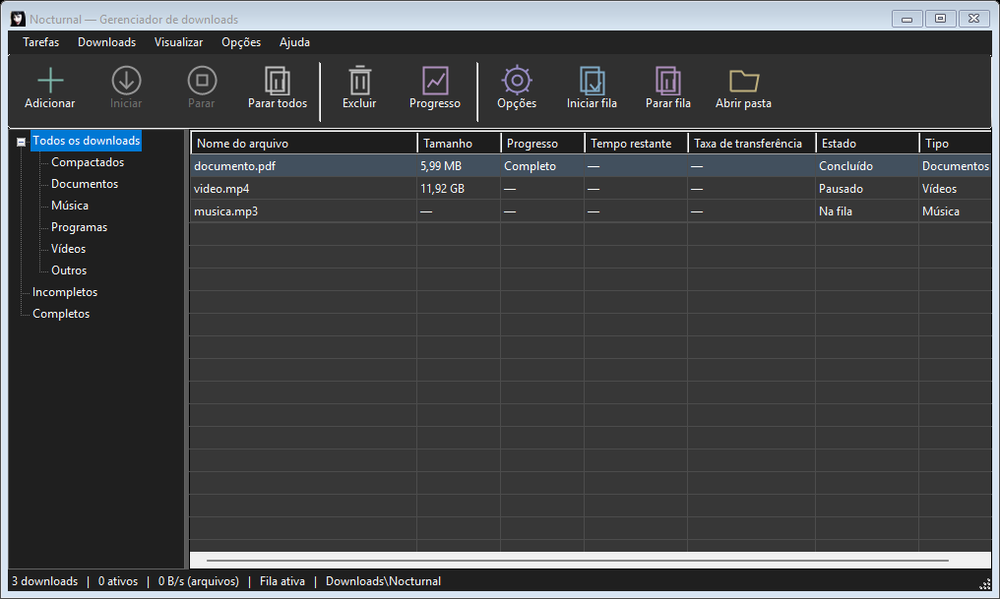
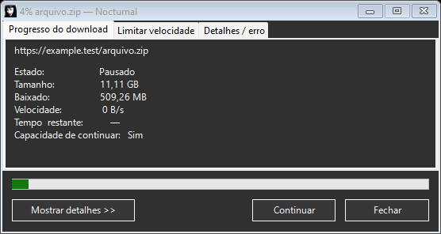
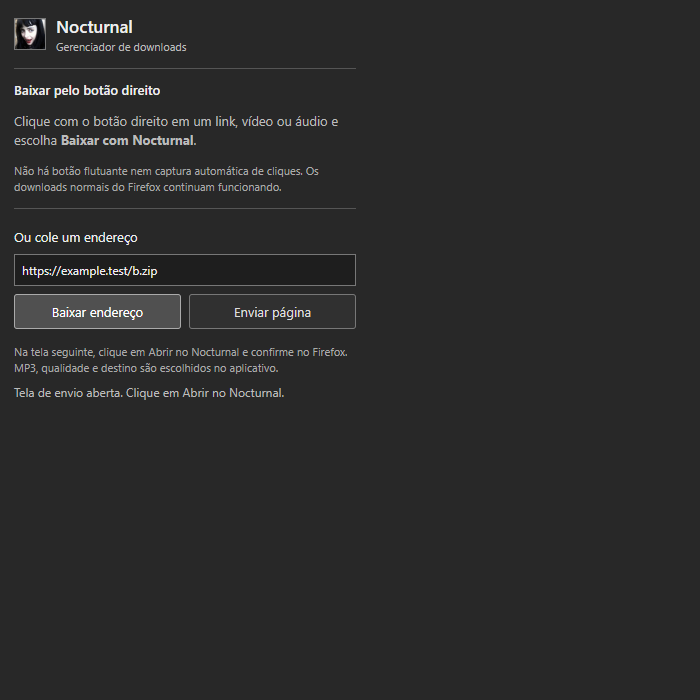

# Nocturnal

Gerenciador de downloads para Windows, com interface clássica escura e extensão para Firefox. **Versão beta 0.18.0** — extensão 0.7.0.



## Recursos

- Downloads HTTP/HTTPS em até oito conexões, quando a origem aceita intervalos e fornece um identificador para retomada.
- Pausa, retomada, fila salva e controle de downloads simultâneos. Tentativa com conexão única quando a origem rejeita intervalos.
- Janela compacta de progresso, aberta ao iniciar, com detalhes de conexões recolhidos. Limite de velocidade e diagnóstico detalhado de erros.
- Categorias e pastas automáticas: Música, Vídeos, Documentos, Compactados, Programas e Outros.
- Vídeo MP4 com resolução selecionável, até 2160p quando disponível na origem.
- Extração de MP3 em 128, 192, 256 ou 320 kbps.
- Extensão Firefox com “Baixar com Nocturnal” no menu do botão direito de links, vídeos e áudios. Sem botão flutuante nem captura automática.
- Interface Windows Forms, sem animações, banners, fontes externas ou navegador embutido.



## Compilar e instalar

Requer Windows com .NET Framework 4.5 ou superior. Recomendado Windows 10/11 com .NET Framework 4.8. Não precisa de um SDK .NET moderno.

No PowerShell, dentro da pasta do projeto:

```powershell
.\scripts\build.ps1
.\scripts\install.ps1
```

O build gera `dist/Nocturnal.exe` e o ZIP da extensão. O instalador local copia o aplicativo para `%LOCALAPPDATA%\Programs\Nocturnal`, cria atalhos e registra `nocturnal://`. Ele exige que o aplicativo esteja fechado e faz backup antes de substituir uma versão existente. Não modifica arquivos já baixados. Ao executar arquivos baixados, o Windows pode mostrar um aviso porque o aplicativo ainda não possui assinatura digital.

### Vídeo e MP3

Downloads de arquivos HTTP/HTTPS não precisam de ferramentas extras. Para vídeo e áudio, coloque estes executáveis na pasta `tools` ao lado de `Nocturnal.exe`:

- `yt-dlp.exe`: [projeto oficial](https://github.com/yt-dlp/yt-dlp).
- `ffmpeg.exe` e `ffprobe.exe`: [FFmpeg](https://ffmpeg.org/) e [builds do projeto yt-dlp](https://github.com/yt-dlp/FFmpeg-Builds).
- `deno.exe`: [projeto oficial](https://github.com/denoland/deno).

Esses programas não são redistribuídos neste repositório nem no pacote básico. Obtenha-os nas respectivas fontes oficiais. Cada componente mantém sua própria licença.

## Firefox

A fonte está em `extension-firefox/`. Para testar temporariamente: abra `about:debugging`, selecione Este Firefox, Carregar extensão temporária e escolha `manifest.json` nessa pasta. A instalação temporária termina ao reiniciar o navegador. Para distribuição permanente, envie o ZIP para assinatura da Mozilla; o ZIP deste projeto ainda não é uma extensão assinada.

Clique com o botão direito e escolha **Baixar com Nocturnal**. Na tela de envio, clique em **Abrir no Nocturnal** e confirme no Firefox. A qualidade, o formato MP3 e a pasta são escolhidos no aplicativo. Os cliques normais e downloads do Firefox não são interceptados.



## Limitações da beta

- Não garante captura de todos os players. Não implementa remoção de DRM.
- Vídeos com URLs blob são enviados como página para o motor de mídia, sem garantia de suporte ao site.
- Links temporários podem expirar. Links que exigem cookies do navegador podem falhar; a extensão não coleta cookies para enviá-los ao aplicativo.
- Retomada de arquivos depende do suporte e dos identificadores fornecidos pelo servidor.
- O limite de mídia entra em vigor no próximo início/retomada; arquivos HTTP aplicam o limite durante a transferência. O limite é por download, não global.
- Testes da extensão foram feitos com APIs simuladas e Chromium; ainda falta validação abrangente no Firefox e em sites reais.

## Privacidade e contribuição

Não inclua filas, arquivos de downloads, tokens ou URLs privadas em issues. Ao relatar um problema, informe a versão, o tipo de download e os passos para reproduzir. O aplicativo guarda sua fila localmente em `%LOCALAPPDATA%\Nocturnal`.

O Nocturnal é independente e não contém código ou recursos extraídos do Internet Download Manager. A implementação atual reutiliza o código recuperado de versões anteriores do próprio Nocturnal.

Código sob licença MIT, conforme [LICENSE](LICENSE). A imagem de marca foi fornecida pelo mantenedor e está excluída dessa licença; este projeto não concede direitos sobre a foto.
